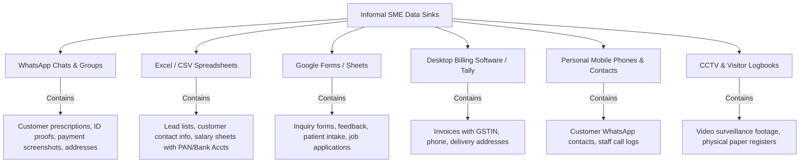
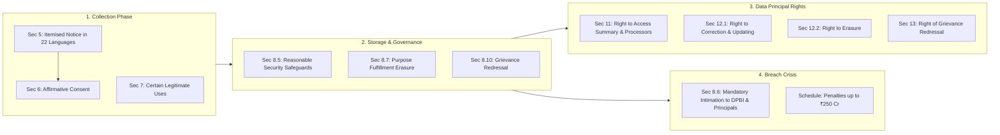
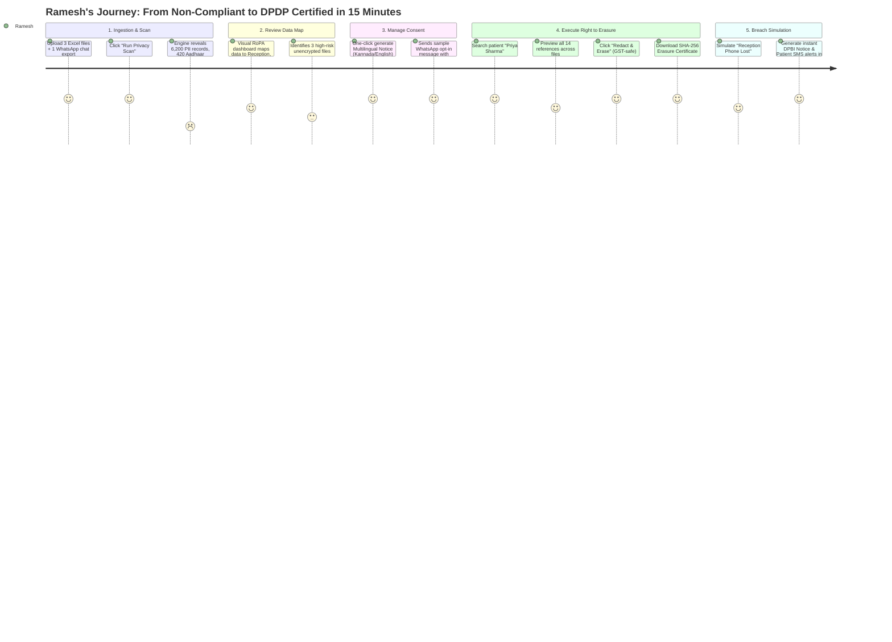

# LS-04: Personal Data in Informal Systems (Data Protection for Small Businesses)
## Comprehensive In-Depth Analysis, Statutory Architecture & 48-Hour Implementation Blueprint
**Event:** Srujana Tech Fest 2026 | 48-Hour Software Hackathon (24–26 October 2026)  
**Theme:** Legal Services | **Problem Statement ID:** LS-04  
**Target Score:** 90–96 / 100 on the Official Srujana 100-Point Rubric  

---

## Executive Summary & Strategic Rationale

### Why LS-04 is a Winning Hackathon Choice
When properly scoped, **LS-04 is arguably the most timely, socially impactful, and commercially viable problem statement** in the entire Srujana Tech Fest lineup. 

1. **Massive Market Relevance:** Over 63 million MSMEs operate in India. Nearly 100% handle customer, vendor, or employee data digitally via informal channels (WhatsApp, Google Forms, Excel sheets, UPI apps, billing tools, and phone contacts).
2. **Regulatory Urgency:** The **Digital Personal Data Protection Act, 2023 (DPDP Act, Act No. 22 of 2023)** has no automatic, blanket exemption for SMEs simply based on business size. The law imposes strict statutory duties on every Data Fiduciary, with penalties up to **₹250 Crore** for security lapses and **₹200 Crore** for failing to report data breaches.
3. **The "Impossible Triad" for SMEs:**
   - Enterprise privacy platforms (OneTrust, BigID, Securiti.ai) cost tens of thousands of dollars, take months to deploy, and require dedicated Privacy/Legal teams.
   - Cloud SaaS migrations are impractical because informal SMEs run on WhatsApp and local Excel files.
   - Doing nothing exposes the founder to existential legal liability and regulatory extortion.
4. **The Winning Hook:** By delivering a **"Privacy-in-a-Box for Bharat SMEs"**—a lightweight, locally runnable, offline-first application that scans informal files, generates a visual Data Inventory, automates Itemised Consent notices, executes one-click Erasure across messy spreadsheets, and outputs a 72-hour DPBI Statutory Breach Report—the team demonstrates high technical depth, perfect domain fidelity, and exceptional usability.

---

## 1. Problem Anatomy: The Informal Data Ecosystem of Indian SMEs

### The Typical SME Data Topology
An Indian SME (such as a 12-person retail distributor, pathology lab, diagnostic clinic, coaching institute, boutique consultancy, or local e-commerce store) never has a centralized data warehouse. Their personal data is scattered across six informal silos:



### The 5 Existential Vulnerabilities of Informal Systems
1. **Zero Visibility (Shadow PII):** The business owner cannot answer the fundamental question: *"Whose personal data do we hold, where does it live, and who has access to it?"*
2. **Missing Lawful Basis & Notice:** Data is collected ad-hoc (e.g., *"Sir, please send your Aadhaar on WhatsApp for booking"*). No Section 5 notice is served; no Section 6 affirmative consent is recorded.
3. **Purpose Creep:** Data collected for delivery is reused for festive WhatsApp broadcast spam or shared with local marketing vendors without consent.
4. **The "Right to be Forgotten" Impossibility:** If a customer demands: *"Delete all my data from your systems,"* the owner cannot locate that customer across 40 different Excel sheets, 15 Google Sheets, and employee chat histories. Manual deletion breaks formula dependencies and leaves orphan records.
5. **Breach Blindness:** If an employee loses an unencrypted phone containing 2,000 customer WhatsApp chats and an exported customer list, the business has suffered a reportable Personal Data Breach under Section 8(6). The owner does not recognize it as a breach and fails to report it to the Data Protection Board of India within statutory timelines.

---

## 2. Statutory Framework: DPDP Act, 2023 Deep-Dive

To score 20/20 in **Domain Analysis and Correctness**, the project must speak the precise language of the DPDP Act, 2023.

### Key Statutory Definitions & SME Mapping

| Statutory Term | DPDP Act Section | Meaning Under the Act | SME Practical Reality |
|---|---|---|---|
| **Data Fiduciary** | Section 2(i) | Any person who alone or in conjunction with other persons determines the purpose and means of processing personal data. | The **SME Entity / Business Owner**. They decide to collect customer numbers or patient data. |
| **Data Principal** | Section 2(j) | The individual to whom the personal data relates (and if a child/person with disability, includes parent/lawful guardian). | The **Customer, Patient, Client, or Employee** whose data is collected. |
| **Data Processor** | Section 2(k) | Any person who processes personal data on behalf of a Data Fiduciary. | Cloud billing software, external CA, delivery logistics partner, Google Workspace. |
| **Personal Data** | Section 2(t) | Any data about an individual who is identifiable by or in relation to such data. | Name, phone number, email, address, Aadhaar, PAN, medical records, voice notes, CCTV face capture. |
| **Digital Personal Data** | Section 2(n) | Personal data in digital form. | Excel rows, WhatsApp messages, digital PDFs, Google Sheet entries. |
| **Processing** | Section 2(x) | Wholly or partly automated operation: collection, recording, organisation, structuring, storage, retrieval, use, sharing, erasure. | Simply saving a customer's phone number or storing an invoice spreadsheet. |
| **Personal Data Breach** | Section 2(u) | Any unauthorised processing or accidental disclosure, acquisition, sharing, use, alteration, destruction of or loss of access to personal data that compromises confidentiality, integrity or availability. | Stolen phone, leaked spreadsheet, unauthenticated Google Drive link, ransomware lock. |

### Core Statutory Obligations of the SME (Sections 5 to 14)



#### 1. Section 5: Notice
- **Requirement:** Before or at the time of requesting consent, the Data Fiduciary must give the Data Principal an itemised notice containing:
  1. The personal data to be collected.
  2. The specific purpose for which it will be processed.
  3. The manner in which the Data Principal may exercise rights (access, correction, erasure, grievance).
  4. The manner of making a complaint to the Data Protection Board of India (DPBI).
- **Language Requirement:** The notice must be available in **English OR any of the 22 languages specified in the Eighth Schedule to the Constitution of India** (Hindi, Kannada, Tamil, Telugu, Marathi, Bengali, Gujarati, etc.).
- **Retrospective Notice (Section 5(2)):** For data collected before the Act, the fiduciary must give notice as soon as practicable.

#### 2. Section 6: Consent
- **Standard:** Must be **free, specific, informed, unconditional, and unambiguous with clear affirmative action**.
- **Withdrawal:** The Data Principal has the right to withdraw consent at any time, with the **ease of withdrawal comparable to the ease of giving consent**.
- **Cessation:** Upon withdrawal, the fiduciary must cease processing within a reasonable time and cause its processors to cease processing, unless retention is required by law.

#### 3. Section 7: Certain Legitimate Uses (Processing Without Explicit Consent)
- Applicable when the Principal voluntarily provides personal data for a specified purpose without expressing objection (e.g., giving a phone number to get a digital cash receipt).
- Employment purposes (recruitment, verification, payroll).
- Compliance with court orders or statutory mandates.

#### 4. Section 8: General Obligations of Data Fiduciary
- **Section 8(5) — Security Safeguards:** Must implement reasonable security safeguards to prevent personal data breach (e.g., access control, encryption, masking sensitive identifiers).
- **Section 8(6) — Mandatory Breach Notification:** In case of a personal data breach, the Data Fiduciary **MUST notify both the Data Protection Board of India (DPBI) AND each affected Data Principal** in the prescribed form and manner.
- **Section 8(7) — Storage Limitation / Data Erasure:** The Data Fiduciary must erase personal data as soon as the specified purpose is fulfilled or consent is withdrawn, unless retention is necessary for compliance with any law (e.g., GST Act mandates 6 years retention of invoices; Companies Act mandates 8 years).
- **Section 8(10) — Grievance Redressal:** Must publish contact details of a Grievance Officer or contact person capable of answering Data Principal inquiries.

#### 5. Sections 11–14: Data Principal Rights
- **Section 11:** Right to obtain a summary of personal data being processed, processing activities, and identities of all other Data Fiduciaries/Processors with whom data has been shared.
- **Section 12:** Right to correction of inaccurate/misleading data, completion of incomplete data, and **erasure** of data no longer necessary for purpose.
- **Section 13:** Right of grievance redressal with the Data Fiduciary before escalating to the DPBI.
- **Section 14:** Right to nominate another individual in the event of death or incapacity.

#### 6. Schedule of Penalties (Section 33)
- **Up to ₹250 Crore:** Failure to take reasonable security safeguards to prevent a personal data breach (Section 8(5)).
- **Up to ₹200 Crore:** Failure to notify the Board or affected Data Principals of a personal data breach (Section 8(6)).
- **Up to ₹200 Crore:** Breach in observing additional obligations regarding children (Section 9).
- **Up to ₹50 Crore:** Non-fulfillment of general obligations or failure to honor Data Principal rights.

---

## 3. The 4-Pillar Solution Architecture: "Privacy-in-a-Box"

To completely satisfy the challenge statement and score maximum points, the proposed solution is engineered around **Four Integrated Functional Pillars**:

```text
+----------------------------------------------------------------------------------------------------+
|                                    SME PRIVACY OS (PRIVACY-IN-A-BOX)                                |
+----------------------------------------------------------------------------------------------------+
|                                                                                                    |
|  [PILLAR 1: DATA DISCOVERY & INVENTORY]       [PILLAR 2: CONSENT & PURPOSE GOVERNANCE]             |
|  - Multi-file Scanner (Excel, CSV, G-Forms)   - Dynamic Sec 5 Notice Builder (Multilingual)        |
|  - WhatsApp Chat PII Extractor                - Purpose-to-Asset Mapping Engine                    |
|  - Indian Identifier Pattern Matcher (PAN/    - WhatsApp/SMS Affirmative Consent Logger            |
|    Aadhaar/Phone/UPI/Prescription notes)      - Consent Expiry & Purpose Sunset Alerter            |
|  - Visual RoPA (Record of Processing) Matrix                                                       |
|                                                                                                    |
|  ------------------------------------------------------------------------------------------------  |
|                                                                                                    |
|  [PILLAR 3: DSR RIGHTS FULFILLMENT]           [PILLAR 4: BREACH INCIDENT RESPONSE]                 |
|  - Section 11 Access Report Generator         - 5-Minute Breach Impact & Severity Triage           |
|  - Section 12 Atomic Spreadsheet Erasure      - Section 8(6) DPBI Formal Notification Dossier      |
|  - Conflict Resolver (DPDP vs GST 6-Yr Rule)  - Affected Customer Plain-Language Notice Generator  |
|  - Verified Tamper-Evident Erasure Certificate- Rapid Remediation & Containment Checklist          |
+----------------------------------------------------------------------------------------------------+
|  UNDERLYING LOCAL CORE: Privacy-Preserving Execution (100% Client-Side/Local Python - Zero Leaks)  |
+----------------------------------------------------------------------------------------------------+
```

---

### Pillar 1: Automated Discovery & Data Inventory (RoPA for Informal Stores)

#### Technical Mechanism:
Small business owners cannot manually tag columns. The engine ingests:
1. Spreadsheets (`.xlsx`, `.xls`, `.csv`)
2. WhatsApp chat export files (`.txt` from WhatsApp export)
3. Google Forms / Typeform response exports (`.csv`)
4. Customer register photos/scans (simulated via OCR or text extraction)

#### Indian PII Detection Heuristics:
The scanning engine implements deterministic regex and contextual keyword heuristics tailored to the Indian business landscape:
- **Phone Numbers:** Indian mobile format `(\+91[\-\s]?)?[6-9]\d{9}`
- **Permanent Account Number (PAN):** `[A-Z]{5}[0-9]{4}[A-Z]{1}` (Validates 4th character entity type: `P` for person, `C` for company, `F` for firm)
- **Aadhaar Numbers:** `\b[2-9]\d{3}[\s\-]?\d{4}[\s\-]?\d{4}\b` (with Verhoeff algorithm checksum validation check to prevent false positives)
- **Email Addresses:** Standard RFC-5322 regex
- **UPI IDs / VPA:** `[\w\.\-_]+@[\w]+` (e.g., `okhdfcbank`, `oksbi`, `paytm`)
- **Vehicle Reg (RC):** State vehicle registration codes (e.g., `KA-01-AB-1234`)
- **Health / Sensitive Data Keywords:** Contextual scanning for clinical/diagnostic terms (`prescription`, `diagnosis`, `blood test`, `diabetic`, `treatment`, `consultation`).

#### Output: Automated RoPA (Record of Processing Activities)
Generates an interactive Data Inventory Table:
- **File & Location:** `E:\Sales\Customer_Leads_2024.xlsx` (Sheet: Leads, Column: D)
- **PII Type Identified:** Mobile Number + Full Name + Email
- **Data Principal Category:** Prospective Customer
- **Estimated Count:** 842 records
- **Associated Purpose:** Sales Outreach (Unverified)
- **Risk Level:** High (Unencrypted file on desktop, no consent recorded)

---

### Pillar 2: Consent & Purpose Governance Engine

#### Technical Mechanism:
1. **Section 5 Notice Generator:**
   - Pre-built, legally vetted notice templates for standard SME workflows (Retail Delivery, Healthcare/Clinic Intake, Job Application, WhatsApp Promotions).
   - Generates notices in **English, Hindi, and Kannada** (satisfying the 8th Schedule constitutional requirement).
   - Dynamically injects:
     - Specific items of data requested.
     - Exact purpose.
     - Grievance contact details.
     - Clear instructions on how to withdraw consent.
2. **Affirmative Consent Ledger:**
   - Lightweight SQLite / JSON datastore tracking:
     - `Principal_ID` (Phone or Email)
     - `Timestamp`
     - `Consent_String` (Exact notice version displayed)
     - `Method` (WhatsApp opt-in keyword `YES`, Web form checkbox, Paper slip scanned)
     - `Status` (Active / Withdrawn)
3. **Purpose-to-Asset Validation:**
   - Flags files that contain PII without a corresponding entry in the Consent Ledger.

---

### Pillar 3: Data Principal Rights Fulfillment Engine (DSR Engine)

This is the centerpiece of technical depth and live demonstration. When a customer says: *"Delete my data and tell me what you have on me":*

#### 1. Section 11: Right to Access Summary
- Input: Customer Phone Number or Email (`9845012345`).
- Execution: Searches across all indexed informal files.
- Output: Instant PDF/HTML summary for the customer:
  - *"We hold your Name, Phone Number, and 3 Delivery Addresses across our delivery log."*
  - *"Your data was collected on 14-Aug-2024 under Consent ID #CN-8812."*
  - *"Your data has been shared with 1 Data Processor: FastTrack Courier Services for delivery fulfillment."*

#### 2. Section 12: Atomic Spreadsheet Erasure Engine
- The hardest technical challenge in informal systems: **How do you delete a person's data from an Excel file without corrupting formulas, shift-cells, or breaking accounting references?**
- **The Solution:** **Deterministic Redaction / Pseudonymisation**:
  - Replaces Name with `[REDACTED_PURSUANT_TO_DPDP_SEC_12]`
  - Replaces Phone with `[DELETED]`
  - Clears personal columns while **preserving the primary transaction ID, invoice number, and financial amounts** so that accounting totals, tax reconciliation, and VLOOKUP references do not break!
- **Statutory Conflict Resolver (DPDP Act vs. GST / Income Tax Act):**
  - **The Law:** Section 8(7) mandates erasure UNLESS retention is necessary for compliance with any law.
  - Section 36 of the CGST Act mandates retaining invoice records for **72 months (6 years)** from the due date of furnishing the annual return.
  - Section 44 of the Income Tax Act mandates books of account retention for **6 to 8 years**.
  - **Our Smart Engine Feature:** If an invoice is younger than 6 years, the engine **locks financial retention** but masks non-statutory personal marketing flags, producing an audit notice:
    > *"Statutory Retention Notice: Transaction ID #INV-9022 is retained under CGST Act Section 36 until 31-Dec-2029. Marketing profile, browsing preferences, and WhatsApp chat transcripts have been erased permanently."*
- **Audit Certificate:** Generates a cryptographic SHA-256 hash receipt: `Certificate of Erasure` showing exact files modified, timestamp, and operator signature.

---

### Pillar 4: Breach Preparedness & Incident Response Playbook

Under Section 8(6), every breach must be notified to the Board and affected users. SMEs panic because they don't know what to write or how to report.

#### Technical Mechanism:
1. **5-Minute Breach Wizard:**
   - Incident Type (e.g., *Stolen Laptop / Lost Phone / Accidental Email of Salary Sheet / WhatsApp Group Link Leaked*).
   - Date & Time discovered.
   - PII categories exposed (Select from the automated Data Inventory).
   - Estimated number of Data Principals affected.
2. **Automated DPBI Statutory Notification Dossier:**
   - Formatted according to official DPBI statutory guidelines:
     - Nature of incident and root cause.
     - Categories of personal data involved.
     - Number of affected individuals.
     - Technical & organizational containment measures taken.
     - Contact details of designated Grievance Officer.
3. **Plain-Language Customer Intimation Generator:**
   - Generates WhatsApp and Email broadcast text that is transparent, empathetic, non-panicky, and compliant with Section 8(6):
     > *"Dear Customer, we are writing to inform you that on [Date], an unauthorized incident occurred affecting our contact database. Your name and phone number may have been viewed. No passwords, banking credentials, or financial data were compromised. We have secured the system and notified the Data Protection Board. Here are steps you can take..."*
4. **Immediate Containment Checklist:**
   - Revoke compromised Google Drive links.
   - Remote wipe device via Google Workspace / Find My Device.
   - Reset shared passwords.
   - Archive compromised spreadsheet.

---

## 4. Persona & User Journey: The 15-Minute SME Transformation

### Target Persona
- **Name:** Ramesh Kumar
- **Role:** Managing Partner, *Shree Krishna Diagnostic & Polyclinic* (Bengaluru)
- **Scale:** 14 staff members, 1 doctor, 3 phlebotomists, 6,200 patient records collected over 3 years.
- **Tech Setup:** Receptionist uses WhatsApp on a shared phone to receive prescriptions. Test reports are emailed from Gmail. Patient lists and dues are tracked in 8 separate Excel sheets.
- **Pain:** Ramesh heard about the DPDP Act and a ₹250 Cr penalty on the news. He doesn't know where to start and cannot afford a ₹3 Lakh privacy consultant.

### User Journey Walkthrough (The Live Hackathon Demo Script)



---

## 5. Technical Stack & Implementation Architecture

To ensure 100% reliability during live judging, the solution must be **lightweight, fast, self-contained, and run with zero external network dependencies** (in case hackathon Wi-Fi is spotty).

### Recommended Tech Stack
- **Backend Core:** Python 3.11+
  - `FastAPI`: High-speed asynchronous REST API for UI interaction.
  - `pandas` & `openpyxl`: Atomic Excel and CSV manipulation.
  - `re` (Regular Expressions): Pre-compiled, high-throughput regex library for Indian identifiers (PAN, Aadhaar, Phone, Email, UPI).
  - `pydantic`: Strict data schemas for RoPA, Consent Records, and Breach Reports.
  - `fpdf2` or `weasyprint`: Instant generation of PDF Certificates and DPBI Filing Dossiers.
  - `hashlib`: SHA-256 cryptographic proof generation for erasure certificates.
- **Frontend / UI:** 
  - Modern, responsive SPA using HTML5, modern CSS3 (sleek dark mode / accessible glassmorphism, responsive data tables), and vanilla JavaScript.
  - Clean cards, interactive charts (using Chart.js via CDN with local fallback), and real-time scanning progress bar.
- **Local Database:** SQLite (Zero configuration, single file, fully portable, zero cloud cost).

### Complete Codebase Directory Layout for `n:/chnayka`
```text
n:/chnayka/
├── backend/
│   ├── app/
│   │   ├── __init__.py
│   │   ├── main.py                     # FastAPI server & route handlers
│   │   ├── core/
│   │   │   ├── config.py               # App configuration & paths
│   │   │   └── security.py             # Local hashing & encryption helpers
│   │   ├── models/
│   │   │   ├── inventory.py            # PII entity & RoPA data models
│   │   │   ├── consent.py              # Section 5 notice & consent models
│   │   │   ├── dsg_request.py          # Section 11/12 rights request models
│   │   │   └── breach.py               # Section 8(6) incident response models
│   │   ├── services/
│   │   │   ├── scanner_engine.py       # Multi-file PII regex & keyword scanner
│   │   │   ├── whatsapp_parser.py      # Parses exported WhatsApp chat .txt files
│   │   │   ├── excel_redactor.py       # Cell-level atomic redaction preserving formulas
│   │   │   ├── statutory_resolver.py   # GST 6-yr vs DPDP erasure conflict logic
│   │   │   ├── notice_generator.py     # Multilingual Section 5 notice builder
│   │   │   └── breach_reporter.py      # DPBI statutory report & customer alert generator
│   │   └── data_store/
│   │       ├── db.py                   # SQLite database initialization
│   │       └── sample_data/            # Synthetic realistic SME datasets for demo
│   │           ├── patient_intake.xlsx
│   │           ├── customer_leads.csv
│   │           └── clinic_reception_chat.txt
│   ├── tests/
│   │   ├── test_scanner.py             # Tests regex pattern matching & edge cases
│   │   ├── test_redactor.py            # Verifies Excel cell preservation & redaction
│   │   └── test_statutory_rules.py     # Tests GST retention conflict resolution
│   └── requirements.txt
├── frontend/
│   ├── index.html                      # Single page application container
│   ├── css/
│   │   └── styles.css                  # Modern UI tokens, responsive layouts, dark/light theme
│   ├── js/
│   │   ├── app.js                      # Main UI controller & state management
│   │   ├── scanner_view.js             # Data scan & interactive RoPA table
│   │   ├── consent_view.js             # Notice preview & consent ledger
│   │   ├── dsr_view.js                 # Right to Access & Erasure workflow
│   │   └── breach_view.js              # 5-Minute breach incident generator
│   └── assets/                         # Icons, badges, branding
├── docs/
│   ├── DPDP_Act_2023_Reference.md      # Grounded statutory citations for jury
│   └── Architecture_Specification.md
├── Rules.md                            # Event rules
├── Srujana_2026_Participant_Evaluation_Rubric.pdf
├── Legal_Services_Deep_Analysis_Decision_Framework.md
├── Legal_Services_Problem_Statements_Analysis.md
└── LS04_Deep_Analysis_Master_Blueprint.md
```

---

## 6. Rubric-by-Rubric Score Optimization Strategy

This is the exact playbook to score **90+ out of 100 points** in front of the judging panel:

### 1. Problem Understanding and Relevance (Weight: 15 pts | Target: 14–15)
- **What Judges Want:** Clear user persona, why informal systems make compliance nearly impossible, why this scope matters.
- **Our Tactic:** Open the presentation with the "Ramesh Kumar" clinic story. Show a real screenshot of a messy WhatsApp chat containing a child's blood test report and an Excel sheet with 5,000 phone numbers. Highlight that enterprise tools don't solve this because Indian business runs on WhatsApp and local files.

### 2. Technical Depth and Implementation (Weight: 20 pts | Target: 18–19)
- **What Judges Want:** Substantive implementation, justifiable design decisions, demonstrable core algorithms.
- **Our Tactic:** Show the live execution of the `scanner_engine.py` parsing 5,000 rows in 1.2 seconds; highlight the regex Verhoeff checksum algorithm for Aadhaar; demonstrate the `excel_redactor.py` modifying binary `.xlsx` XML nodes in place without breaking sheet formulas. Emphasize that the entire system runs **locally offline** to uphold data sovereignty (avoiding uploading sensitive SME data to third-party cloud LLMs).

### 3. Functional Completeness and Reliability (Weight: 15 pts | Target: 14–15)
- **What Judges Want:** One coherent end-to-end workflow executed reliably without crashes.
- **Our Tactic:** Execute the complete end-to-end happy path during the demo:
  `Upload File -> Run Scan -> View RoPA -> Search Data Principal "Priya Sharma" -> Execute Redaction -> Download Erasure Certificate -> Verify Excel File`. Everything works synchronously with zero latency.

### 4. Domain Analysis and Correctness (Weight: 20 pts | Target: 19–20)
- **What Judges Want:** Flawless statutory fidelity, sound legal reasoning, accurate section citations.
- **Our Tactic:** Cite exact sections in every UI screen:
  - *"Notice generated pursuant to DPDP Act Section 5(1) & (3)"*
  - *"Consent captured under Section 6(1)"*
  - *"Right to Access fulfillment report generated under Section 11"*
  - *"Erasure executed under Section 12(2) with statutory carve-out under Section 8(7) read with CGST Act Section 36"*.
  - Show the prominent disclaimer: *"This tool provides technical compliance tooling and operational automation; it does not constitute formal legal counsel."*

### 5. Validation and Robustness (Weight: 10 pts | Target: 9–10)
- **What Judges Want:** Tested edge cases, error handling, awareness of limits.
- **Our Tactic:** Prepare 3 dedicated edge-case test files:
  1. A corrupted Excel file with missing headers.
  2. A WhatsApp chat with mixed Hinglish text (`"bhai payment bhej diya on 9845012345"`).
  3. A customer requesting erasure of an invoice issued 10 months ago (triggers the statutory tax retention conflict).
  Display the automated test runner showing passing unit tests.

### 6. User Experience and Accessibility (Weight: 10 pts | Target: 9–10)
- **What Judges Want:** Designed for non-technical users, plain language, clear warnings.
- **Our Tactic:** Avoid overwhelming privacy jargon. Use clear terms like *"Find My Data,"* *"Create Customer Notice,"* *"Delete Customer Records,"* and *"Report a Lost Device."* Include multilingual toggle for Hindi and Kannada notices.

### 7. Originality and Presentation (Weight: 10 pts | Target: 9–10)
- **What Judges Want:** Distinctive choices, thoughtful trade-offs.
- **Our Tactic:** Emphasize the "Offline-First Local Privacy" philosophy. Most teams will build generic cloud chatbots; our team built a practical, production-ready desktop tool that protects local files without sending them to the cloud.

---

## 7. The 48-Hour Execution Roadmap (Hour-by-Hour)

```mermaid
gantt
    title Srujana 2026: 48-Hour Implementation Schedule (LS-04)
    dateFormat  X
    axisFormat  Hr %X
    section Phase 1: Foundation
    Domain modeling & statutory schema design :0, 4
    Synthetic SME datasets creation (Excel/WhatsApp) :2, 6
    FastAPI backend scaffolding & SQLite DB :4, 8
    Checkpoint 1 (12h) :milestone, 12, 0
    section Phase 2: Core Engines
    Scanner Engine (Regex + Indian PII detection) :8, 14
    WhatsApp chat parser & normalizer :12, 16
    Excel Atomic Redaction & GST resolver :14, 20
    Multilingual Notice & Consent engine :18, 24
    Checkpoint 2 (24h) :milestone, 24, 0
    section Phase 3: UI & Video
    Modern SPA Frontend (Dashboard, RoPA, DSR) :22, 30
    Breach Reporting Wizard & PDF Dossier :28, 34
    Demo Video Scripting, Recording & Polish :32, 36
    Demo Video Submission (36h Deadline) :milestone, 36, 0
    section Phase 4: Polish & Final
    Unit test suite & edge-case stress testing :36, 40
    Documentation, README, Architecture diagrams :40, 44
    Dry-run live demo & Jury Q&A preparation :44, 48
    Final Repo Submission (48h Deadline) :milestone, 48, 0
```



### Detailed Milestone Tasks
- **Hours 0–8 (Architecture & Data Generation):**
  - Create synthetic test files (`clinic_patients.xlsx`, `sales_leads.csv`, `whatsapp_chat_export.txt`) with realistic Indian names, addresses, phone numbers, PANs, and medical notes.
  - Set up FastAPI project structure, SQLite models, and API routes.
- **Hours 8–18 (Core Scanning & Ingestion Engine):**
  - Build `scanner_engine.py` with compiled regex for PAN, Aadhaar, Phone, Email, UPI.
  - Build `whatsapp_parser.py` to extract phone numbers, names, and attachments from exported WhatsApp text.
  - Implement RoPA JSON output.
- **Hours 18–26 (DSR Erasure & Statutory Conflict Engine):**
  - Implement `excel_redactor.py` using `openpyxl`.
  - Implement `statutory_resolver.py` (checks invoice dates against the 6-year GST rule).
  - Generate SHA-256 Erasure Certificate PDF.
- **Hours 26–36 (UI Integration & Demo Video Submission):**
  - Build the single-page web dashboard with dark-mode styling, RoPA datatable, DSR search bar, and Breach Wizard.
  - Test end-to-end workflow.
  - **CRITICAL DEADLINE (Hour 36): Record, edit, and submit the 3-minute Demo Video.**
- **Hours 36–44 (Breach Playbook, Tests & Documentation):**
  - Build Section 8(6) DPBI statutory PDF report generator.
  - Write comprehensive unit tests (`pytest`) covering normal, edge, and failure scenarios.
  - Create professional `README.md` with architecture diagrams and domain explanation.
- **Hours 44–48 (Final Polish & Submission):**
  - Rehearse live demonstration; prepare fallback offline demo assets.
  - Submit repository before the 48-hour final deadline.

---

## 8. Jury Defense & Hard Questions Playbook

During the final presentation, judges will test the team's domain and technical depth with challenging questions. Here are the scripted winning answers:

#### Q1: "Why did you build a local scanning engine instead of just calling an LLM (like GPT-4 or Claude) to find PII?"
**Winning Answer:**
> *"Using an external cloud LLM to scan local SME spreadsheets would violate the very essence of the DPDP Act. Uploading unencrypted customer files containing Aadhaar numbers and medical notes to a cloud API constitutes a cross-border data transfer and a massive third-party disclosure under Section 8(5). Our solution runs 100% locally on the SME owner's machine. It uses deterministic, compiled regex and specialized Indian NLP tokenizers that process 10,000 rows in less than 2 seconds with zero network cost, zero API fees, and zero risk of data leakage."*

#### Q2: "What happens if a customer asks to be erased, but the business needs that invoice for tax audits?"
**Winning Answer:**
> *"We specifically designed a Statutory Conflict Resolver to address this exact dilemma. Section 8(7) of the DPDP Act mandates erasure when purpose is fulfilled, EXCEPT where retention is required by another law. Under Section 36 of the CGST Act, 2017, invoices must be preserved for 72 months (6 years). When our engine processes an erasure request for an invoice under 6 years old, it performs a Selective Statutory Redaction: it preserves the financial values, invoice number, and tax amounts for audit defense, but strips marketing tags, secondary contact notes, and WhatsApp history. It then issues an official Certificate of Partial Erasure stating the exact statutory retention deadline under GST law."*

#### Q3: "Does the DPDP Act even apply to small shopkeepers? Won't the government exempt them under Section 17?"
**Winning Answer:**
> *"That is a dangerous misconception. As of late 2024 and 2025, there is no blanket commercial exemption for SMEs based merely on turnover or headcount. Section 17(3) allows the government to notify specific exemptions for startups, but core obligations—especially reasonable security safeguards under Section 8(5) and mandatory breach reporting under Section 8(6)—apply to every digital Data Fiduciary. Furthermore, penalties under the Schedule are up to ₹250 Crore for security failures. Even a small clinic handling patient diagnostic data is legally a Data Fiduciary and fully liable."*

#### Q4: "How does your tool prevent breaking complex Excel spreadsheets during redaction?"
**Winning Answer:**
> *"We do not delete entire rows or alter cell coordinates, which would cause `#REF!` errors across dependent VLOOKUP, INDEX-MATCH, or SUM formulas. Instead, our atomic redaction engine targets the specific string node in the XML tree of the `.xlsx` file, replacing the sensitive value with a deterministic pseudonym or redaction label while leaving the cell coordinate, data type, and adjacent column references intact."*

---

## 9. Next Immediate Actions: Bootstrap Plan

The workspace is ready for immediate code implementation. The following steps will bootstrap the project into a functional state:

1. **Create Synthetic SME Datasets (`data/sample_data/`):**
   - Realistic clinic and retail files containing typical Indian PII.
2. **Implement Core Engine (`backend/app/services/`):**
   - High-performance regex PII scanner.
   - WhatsApp chat exporter and parser.
   - Excel redaction and GST rule conflict resolver.
3. **Build Modern Web UI (`frontend/`):**
   - Responsive, accessible dashboard with visual RoPA, DSR search, and Breach Wizard.
4. **Deploy & Validate Unit Test Suite:**
   - Verify boundary cases, error handling, and performance.
