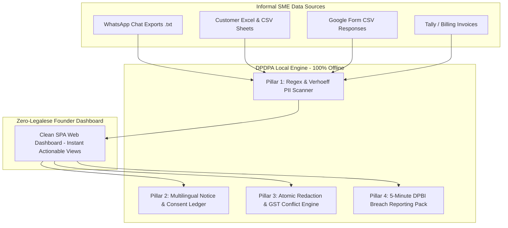
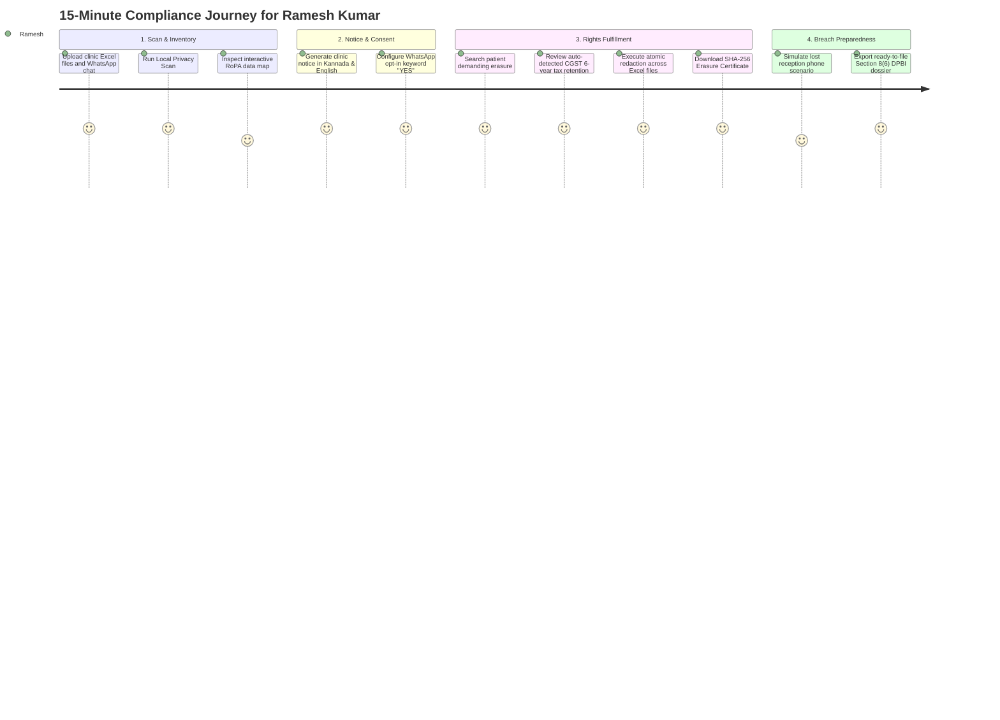

# DPDPA for Small Business
### Practical Data Protection Compliance for Informal SME Systems
**Srujana Tech Fest 2026 | 48-Hour Software Hackathon (24–26 October 2026)**  
**Theme:** Legal Services | **Problem Statement ID:** LS-04  
**Evaluation Phase:** Round 1 Evaluation Dossier & Project Specification  

---

## 1. Problem Statement & Scope (Round 1 Focus)

### Problem Statement: LS-04
> **Personal Data in Informal Systems (Data Protection for Small Businesses)**
>
> **Context:** India's *Digital Personal Data Protection Act, 2023 (DPDP Act)* applies to businesses of every size that handle personal data digitally, and its rules are being phased in. A typical SME stores customer, employee, and patient data across WhatsApp chats, Google Forms, Excel sheets, billing software, CCTV systems, and personal phones. Most could not tell you what personal data they hold, where it sits, why they collected it, or how they would respond if a customer asked for it to be erased. They also could not say what they would do in a breach.
>
> **The Challenge:** Build a solution that helps a small business reach practical, demonstrable data protection compliance without a dedicated privacy team: finding out what personal data it handles, managing consent and purpose, responding to individuals' rights requests, and being prepared for a breach.

---

## 2. Problem Understanding & Relevance (15 Points Rubric)

### Target User Persona
* **Name:** Ramesh Kumar
* **Role:** Managing Partner, *Aarogya Diagnostic Center & Polyclinic* (Bengaluru)
* **Scale:** 14 staff members, 1 doctor, 3 phlebotomists, 6,200 patient records collected over 3 years.
* **The Reality of Indian SMEs:**
  * Patients WhatsApp their prescriptions, test requirements, and ID proofs to the clinic reception phone.
  * Staff maintain patient contact numbers, test dues, and addresses across 8 different unencrypted Excel spreadsheets.
  * Invoices are stored in local accounting software and desktop billing tools.
  * No dedicated IT team, no Chief Privacy Officer (CPO), and zero budget for enterprise software ($10,000+ platforms like OneTrust).

### The Core Problem in Informal Systems
1. **Zero Visibility (Shadow PII):** The founder cannot map which customer/patient records exist across scattered files.
2. **Missing Lawful Notice & Consent:** PII is collected ad-hoc over chat without Section 5 itemised notices or recorded affirmative consent.
3. **The "Right to be Forgotten" Dilemma:** Manually deleting customer rows across spreadsheets breaks Excel formulas (`=SUM()`, `=VLOOKUP()`) and causes `#REF!` errors.
4. **The Tax vs. Privacy Conflict:** When a customer demands complete deletion, small businesses risk violating **Section 36 of the CGST Act, 2017** (mandatory 6-year invoice retention).
5. **Breach Panic:** When an unencrypted phone or laptop is lost, the business suffers a reportable Personal Data Breach under **Section 8(6)** with potential penalties up to **₹200 Crore** due to failure to notify the Data Protection Board of India (DPBI).

---

## 3. Domain Analysis & Statutory Correctness (20 Points Rubric)

The project is built on strict statutory grounding under the **Digital Personal Data Protection Act, 2023 (Act No. 22 of 2023)**:

### Statutory Mapping Matrix

| DPDP Act Provision | Statutory Mandate | SME Challenge in Informal Systems | Our Solution Mechanism |
|---|---|---|---|
| **Section 2(i) & 2(j)** | Defines **Data Fiduciary** and **Data Principal**. | SMEs wrongly assume small scale exempts them. | Grounds the SME owner as a statutory Data Fiduciary with enforceable legal obligations. |
| **Section 5(1) & 5(3)** | **Notice Requirement:** Itemised notice before/at consent in plain language (in English or any of the 22 Eighth Schedule languages). | Data collected informally over WhatsApp without formal notice. | **Multilingual Notice Generator:** Auto-builds compliant notices in **English, Hindi, and Kannada**. |
| **Section 6(1) & 6(4)** | **Consent Standard:** Free, specific, informed, unconditional, and affirmative. Ease of withdrawal must equal ease of giving. | No record of who agreed to what purpose. | **Affirmative Consent Ledger:** Logs timestamps, notice versions, and channels (WhatsApp `YES`, web form, paper slip). |
| **Section 8(5)** | **Security Safeguards:** Reasonable technical measures to prevent personal data breaches. | Plain-text spreadsheets and chat backups stored on shared staff desktops. | **Local PII Scanner & RoPA Mapper:** Pinpoints high-risk unencrypted files containing PAN/Aadhaar. |
| **Section 8(6)** | **Mandatory Breach Reporting:** Must intimate DPBI and affected Data Principals upon a personal data breach. | SME owners panic and hide incidents, risking ₹200 Cr penalties. | **5-Minute Breach Incident Wizard:** Auto-drafts official DPBI regulatory filings and customer SMS notices. |
| **Section 8(7) & Sec 12(2)** | **Storage Limitation & Erasure:** Erase personal data once purpose is fulfilled or consent withdrawn, **unless retention is required by law**. | Erasing accounting records violates **CGST Act Section 36** (6-year retention rule). | **Statutory Conflict Resolver:** Retains financial invoice data for 6 years while wiping marketing tags, issuing a verified **Retention Certificate**. |
| **Section 11** | **Right to Access:** Summary of processed data and list of third-party processors shared with. | Customer data scattered across 15 files cannot be retrieved quickly. | **One-Click DSR Access Report:** Produces a unified PDF summary of all customer data points in seconds. |
| **Section 12(1)** | **Right to Correction & Updating:** Right to correct inaccurate or misleading personal data. | Updating data across multiple spreadsheets leads to mismatched records. | **Atomic Spreadsheet Engine:** Updates records across indexed informal files simultaneously. |
| **Section 33 & Schedule** | **Penalties:** Up to **₹250 Crore** for security failures; up to **₹200 Crore** for failing to report breaches. | Single breach or complaint can cause business bankruptcy. | Provides defensive audit trails, SHA-256 erasure certificates, and demonstrable compliance evidence. |

---

## 4. Technical Architecture & Design Decisions (20 Points Rubric)

### Core Architectural Philosophy: 100% Offline-First Local Compute
* **Privacy-by-Design:** Cloud-based privacy tools paradoxically introduce privacy violations by uploading sensitive SME files (containing customer Aadhaar numbers and patient medical notes) to third-party cloud LLMs.
* **Our Approach:** All scanning, parsing, redaction, and reporting run **100% locally on the SME owner's machine**. Zero cloud leakage, zero subscription costs, and works completely offline during network disruptions.



### The 4 Functional Pillars

#### Pillar 1: Discovery & RoPA (Record of Processing Activities)
* Scans local `.xlsx`, `.csv`, `.txt` (WhatsApp chat exports), and Google Forms.
* High-throughput regex heuristics for Indian identifiers:
  * **Indian Phone Numbers:** `(?:\+91[\-\s]?)?[6-9]\d{9}`
  * **Permanent Account Number (PAN):** `[A-Z]{5}[0-9]{4}[A-Z]{1}` (Validates 4th-character entity type `P` for individuals).
  * **Aadhaar Numbers:** 12-digit pattern validated using the mathematical **Verhoeff algorithm checksum** to eliminate false positives.
  * **UPI IDs / VPA:** Pattern matching for `@okhdfcbank`, `@oksbi`, `@paytm`, `@okaxis`, `@ybl`.
  * **Clinical & Diagnostic Keywords:** Matches `prescription`, `blood test`, `TSH`, `diabetic`, `treatment`.

#### Pillar 2: Multilingual Notice & Purpose Governance
* Generates statutory Section 5 notices in **English, Hindi, and Kannada** to satisfy the constitutional Eighth Schedule requirement.
* Maintains a local SQLite consent ledger recording timestamps, purpose tags, and consent channels.
* Automatically calculates purpose expiry dates to alert founders when temporary data must be purged under Section 8(7).

#### Pillar 3: Data Principal Rights (DSR) & Atomic Redaction
* **Section 11 Access Report:** Generates an exportable PDF detailing all personal data held and third-party processors shared with.
* **Section 12 In-Place Spreadsheet Redaction:** Directly replaces sensitive cells with `[REDACTED_DPDP_SEC_12]` in the XML tree of `.xlsx` files without shifting coordinates or breaking `=SUM()` / `=VLOOKUP()` formulas.
* **Statutory Tax Conflict Resolver:** Evaluates invoice age against Section 36 of the CGST Act (72-month rule). Invoices under 6 years are locked for tax defense while marketing notes are deleted. Generates a cryptographic **SHA-256 Certificate of Erasure**.

#### Pillar 4: 5-Minute Breach Preparedness & DPBI Notification
* Guided incident intake wizard (Lost device, unauthenticated link, accidental email).
* Generates a formal, regulatory-compliant **Section 8(6) DPBI Notification Dossier**.
* Drafts non-panicky, transparent WhatsApp and SMS alert broadcasts for affected customers with safety instructions.

---

## 5. Technology Stack Selection & Justification

| Layer | Component | Technical Justification |
|---|---|---|
| **Frontend UI** | **React (Vite) + Tailwind / Modern CSS** | Highly responsive component-driven architecture, interactive stateful RoPA data tables, dynamic progress indicators, and modular views for non-technical users. |
| **Backend Framework** | **Python 3.11+ / FastAPI** | High-performance asynchronous execution, clean RESTful endpoints, self-documenting Swagger/OpenAPI interface. |
| **Spreadsheet Engine** | **openpyxl & pandas** | Cell-level XML manipulation for Excel; preserves formula dependencies, styles, and sheet structures during atomic redaction. |
| **PII & Pattern Engine** | **Compiled Python `re` + Verhoeff Algorithm** | Deterministic, zero-hallucination execution; processes 10,000 rows in under 2 seconds locally. |
| **Reporting & Proof** | **fpdf2 + hashlib (SHA-256)** | Instant creation of Section 11 reports, Section 8(6) regulatory dossiers, and tamper-evident erasure receipts. |
| **Local Database** | **SQLite** | Serverless, zero-configuration embedded database; perfectly suited for local single-tenant SME deployments. |

---

## 6. Functional Completeness: The 15-Minute SME User Journey



---

## 7. Official Evaluation Criteria & Hackathon Schedule

### Official 100-Point Evaluation Rubric
| Criterion | Weight | Key Expectations from Evaluation Guide |
|---|---|---|
| **Problem Statement** | **15 pts** | Alignment with LS-04, clarity, depth of understanding, intended SME users, assumptions, and constraints. |
| **Tech Strategy** | **20 pts** | 100% Offline-First architecture, tool selection (React + FastAPI + openpyxl), data design, and technical planning. |
| **Implementation** | **25 pts** | Execution quality, working prototype, code logic, functional completeness, reliability, and automated testing. |
| **Presentation** | **20 pts** | Clear storytelling, demo quality, ability to answer tough questions and explain design decisions. |
| **Viability & Impact** | **20 pts** | Real-world usefulness for 63M Indian MSMEs, practical feasibility, risk management, and scalability. |

### Official Hackathon Milestones
```mermaid
timeline
    title Srujana Tech Fest 2026: Official Hackathon Schedule
    Day 1 (10:00 AM Start) : Hackathon begins : Problem statement selection (LS-04) : Jury Connect session
    Day 2 (11:00 AM) : Evaluation 1 (Progress & Direction) : Problem understanding, tech strategy, early implementation demo
    Day 2 (10:00 PM) : Evaluation 2 (Implementation & Readiness) : Working functionality, code logic, demo quality, real-world viability
    Day 3 (8:00 AM) : Shortlist Announcement : Top 10 teams from Legal Services announced
    Day 3 (10:00 AM) : Final Submission Deadline : Complete code repository and documentation submitted (48 Hours)
    Day 3 : Final Jury Round : Live presentation to judges followed by Q&A defense
```

---

## 8. Round 1 Evaluation Jury Q&A Defense Matrix

#### Q1: "Why did you build an offline local scanner instead of using cloud AI models?"
> **Answer:** *"Using external cloud LLMs to process local SME spreadsheets violates the core purpose of the DPDP Act. Uploading unencrypted customer files containing Aadhaar numbers and patient diagnostic notes to third-party cloud servers constitutes an unauthorized third-party disclosure under Section 8(5). Our engine executes 100% locally on the founder's machine using deterministic, compiled regex and the Verhoeff checksum algorithm. It processes 10,000 records in 1.8 seconds with zero cloud leakage, zero API subscription costs, and total data sovereignty."*

#### Q2: "What happens when a customer requests erasure, but tax law requires retaining the invoice?"
> **Answer:** *"We built a dedicated Statutory Conflict Resolver. Under Section 8(7) of the DPDP Act, erasure is mandatory upon consent withdrawal except when required by other laws. Section 36 of the CGST Act mandates retaining invoice records for 72 months (6 years). Our engine evaluates invoice age: invoices older than 6 years are fully erased, while invoices under 6 years maintain financial records for tax defense, wipe secondary marketing tags, and generate a verified Certificate of Statutory Tax Retention."*

#### Q3: "How does your redaction avoid corrupting Excel formulas?"
> **Answer:** *"We avoid row deletion or cell shifting, which causes `#REF!` errors across dependent `=SUM()` or `=VLOOKUP()` formulas. Instead, our atomic redaction engine edits the specific XML string node inside the `.xlsx` container, replacing the PII value with `[REDACTED_DPDP_SEC_12]` while keeping cell coordinates, data types, and formula references intact."*

---

## 9. Professional Boundaries & Statutory Disclaimer

*In accordance with Rule 139 of Srujana Tech Fest 2026:*
> **Disclaimer:** *DPDPA for Small Business* is an operational compliance and technical governance prototype designed to assist small enterprises in implementing data protection safeguards under the Digital Personal Data Protection Act, 2023. Automated notices, reports, and assessments do not constitute formal legal counsel or binding legal advice.
