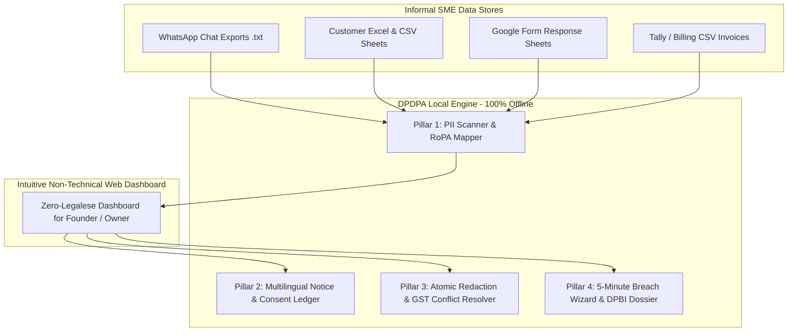

# DPDPA for Small Business
### Privacy-in-a-Box for Small Businesses & Informal Systems
**48-Hour Software Hackathon | Srujana Tech Fest 2026 (24–26 October 2026)**  
**Theme:** Legal Services | **Problem Statement:** LS-04: Personal Data in Informal Systems  

---

## 1. Problem Statement Overview

### Official Problem ID: LS-04
> **Personal Data in Informal Systems (Data Protection for Small Businesses)**
>
> **Context:** India's *Digital Personal Data Protection Act, 2023 (DPDP Act)* applies to businesses of every size that handle personal data digitally, and its rules are being phased in. A typical SME stores customer, employee and patient data across WhatsApp chats, Google Forms, Excel sheets, billing software, CCTV systems and personal phones. Most could not tell you what personal data they hold, where it sits, why they collected it, or how they would respond if a customer asked for it to be erased. They also could not say what they would do in a breach.
>
> **The Challenge:** Build a solution that helps a small business reach practical, demonstrable data protection compliance without a dedicated privacy team. That means finding out what personal data it handles, managing consent and purpose, responding to individuals' rights requests, and being prepared for a breach.

---

## 2. What We Are Building: "DPDPA for Small Business"

**DPDPA for Small Business** is an offline-first, local-executable **"Privacy-in-a-Box"** platform designed specifically for Indian micro, small, and medium enterprises (MSMEs). 

Small business owners don't have dedicated legal teams, Data Protection Officers (DPOs), or enterprise budgets for software like OneTrust. Their businesses run on **WhatsApp chats, messy Excel spreadsheets, Google Forms, and billing exports**.

DPDPA for Small Business bridges this critical gap by giving SME founders a simple, automated, and non-technical tool that achieves **demonstrable DPDP Act compliance in under 15 minutes**.



---

## 3. The 4 Functional Pillars We Implement

### 🔍 Pillar 1: Automated Discovery & Data Inventory (RoPA)
* **Informal Data Ingestion:** Scans unencrypted `.xlsx`, `.csv`, `.txt` (WhatsApp chat exports), and Google Form exports directly from the user's computer.
* **Indian PII Pattern Recognition:** Implements high-throughput, compiled regex and heuristic tokenizers designed for Indian identifiers:
  * **Indian Mobile Numbers:** Standard `+91` and 10-digit formats starting with 6–9.
  * **Aadhaar Numbers:** 12-digit pattern matching with **Verhoeff algorithm checksum verification** to eliminate false positives.
  * **Permanent Account Number (PAN):** Standard 10-character alphanumeric syntax with entity-type verification (`P` for individual).
  * **UPI IDs / VPA:** Handles for `@okhdfcbank`, `@oksbi`, `@paytm`, `@okaxis`, `@ybl`, etc.
  * **Sensitive Diagnostic / Medical Keywords:** Clinical terms (`prescription`, `blood sugar`, `TSH`, `treatment`).
* **Interactive RoPA Table:** Generates an instant **Record of Processing Activities** showing files, row coordinates, identified PII types, estimated counts, and security risk levels.

### 📝 Pillar 2: Multilingual Notice & Purpose Governance
* **Section 5 Notice Generator:** Generates legally sound, itemised collection notices in **English, Hindi, and Kannada** (satisfying the 8th Schedule constitutional requirement).
* **Affirmative Consent Ledger:** Lightweight local ledger recording consent timestamps, notice versions, and channels (WhatsApp opt-in keyword `YES`, web form checkbox, or counter registration).
* **Purpose Sunset Alerter:** Automatically tracks when data collected for temporary purposes has expired and prompts the owner for deletion pursuant to Section 8(7).

### 🛡️ Pillar 3: Data Principal Rights (DSR) & Atomic Redaction
* **Section 11 (Right to Access):** Generates a customer-facing summary PDF stating all personal data held and third-party processors it was shared with (e.g., delivery couriers).
* **Section 12 (Atomic Spreadsheet Erasure):** Directly redacts personal data inside messy `.xlsx` and `.csv` files **without breaking sheet formulas, shifting cell coordinates, or corrupting accounting totals**.
* **Statutory Conflict Resolver (DPDP Sec 8(7) vs. CGST Sec 36):**
  * *The Dilemma:* Customer requests erasure, but tax law requires invoice retention.
  * *Our Solution:* Automatically checks invoice age. Invoices older than 6 years are 100% erased. Invoices younger than 6 years have financial amounts locked for tax audit compliance while secondary marketing tags are wiped, accompanied by a **Statutory Retention Certificate**.
* **Cryptographic Tamper-Evident Proof:** Generates a SHA-256 hashed Certificate of Erasure for legal protection.

### 🚨 Pillar 4: Breach Preparedness & Incident Response
* **5-Minute Incident Wizard:** Triage lost phones, leaked Google Drive links, or sent-in-error emails.
* **Section 8(6) DPBI Statutory Dossier:** Auto-generates the formal regulatory breach notice ready for submission to the Data Protection Board of India.
* **Plain-Language Customer Alert Generator:** Creates non-panicky, transparent WhatsApp and SMS messages informing affected customers with actionable guidance.

---

## 4. Complete Technology Stack

| Layer | Technology | Rationale & Justification |
|---|---|---|
| **Frontend UI** | **Vanilla HTML5, CSS3, Modern JavaScript** | Zero bloated dependencies; instantaneous load times; full responsive design with dark mode; runs cleanly on any browser without complex compilation. |
| **Data Visualizations** | **Chart.js** (with local fallback) | Lightweight interactive charts for PII distribution, file exposure, and consent status. |
| **Backend API** | **Python 3.11+ / FastAPI** | High-performance asynchronous REST API; auto-generates OpenAPI documentation; straightforward to inspect during hackathon judging. |
| **Spreadsheet Engine** | **openpyxl & pandas** | Cell-level XML node editing for Excel files; preserves column coordinates, number formatting, and `=SUM()`/`=VLOOKUP()` formulas. |
| **PII & NLP Engine** | **Compiled Python `re` + Verhoeff Algorithm** | Ultra-fast, deterministic pattern matching; zero hallucinations; processes 10,000 spreadsheet rows in under 2 seconds. |
| **Document Generation** | **fpdf2 / WeasyPrint** | Instant generation of Section 11 Access Reports, Section 8(6) DPBI Breach Dossiers, and SHA-256 Erasure Certificates. |
| **Database** | **SQLite** | Embedded, serverless, single-file database; zero setup required; zero maintenance cost for small businesses. |
| **Architecture Paradigm** | **100% Offline-First Local Compute** | **Privacy by Design:** Processing happens strictly on the local machine. Sensitive SME data is **never transmitted to external cloud APIs or LLMs**, eliminating third-party data leakage risks. |

---

## 5. System Architecture & Data Flow

```text
+-----------------------------------------------------------------------------------------+
|                                    USER INTERFACE                                       |
|  [Scan Workspace]   [Data Map (RoPA)]   [Consent & Notices]   [DSR Portal]   [Breach]  |
+-----------------------------------------------------------------------------------------+
                                           │  REST API Calls (FastAPI)
                                           ▼
+-----------------------------------------------------------------------------------------+
|                                    BACKEND ENGINE                                       |
|                                                                                         |
|  ┌─────────────────────┐   ┌──────────────────────────┐   ┌──────────────────────────┐  |
|  │  scanner_engine.py  │   │     excel_redactor.py    │   │  statutory_resolver.py   │  |
|  │  - Phone / Email    │   │  - Atomic cell redaction │   │  - DPDP Sec 8(7) vs      │  |
|  │  - PAN with Type    │   │  - Preserves formulas    │   │    CGST Sec 36 (6-year)  │  |
|  │  - Verhoeff Aadhaar │   │  - SHA-256 Hash receipts │   │  - Selective Retention   │  |
|  └─────────────────────┘   └──────────────────────────┘   └──────────────────────────┘  |
|                                                                                         |
|  ┌─────────────────────┐   ┌──────────────────────────┐   ┌──────────────────────────┐  |
|  │ whatsapp_parser.py  │   │    notice_generator.py   │   │    breach_reporter.py    │  |
|  │ - Parses chat logs  │   │  - Sec 5 Multilingual    │   │  - Sec 8(6) DPBI Dossier │  |
|  │ - Extracts PII/UPI  │   │  - Eng, Hindi, Kannada   │   │  - Customer Alert Text   │  |
|  └─────────────────────┘   └──────────────────────────┘   └──────────────────────────┘  |
+-----------------------------------------------------------------------------------------+
                                           │
                                           ▼
+-----------------------------------------------------------------------------------------+
|                                LOCAL FILE STORAGE                                       |
|  SQLite DB (Consent Ledger)  │  Target Spreadsheets (.xlsx/.csv)  │  WhatsApp Chats (.txt)|
+-----------------------------------------------------------------------------------------+
```

---

## 6. Target User Persona: Ramesh Kumar

* **Who:** Ramesh Kumar, Managing Partner at *Aarogya Diagnostic Center & Polyclinic* (Bengaluru).
* **Team & Operations:** 14 employees, 1 doctor, 3 phlebotomists, 6,200 patient records collected over 3 years.
* **Current Informal Setup:**
  * Patients WhatsApp their prescriptions and Aadhaar cards to the clinic reception phone.
  * Staff keep test dues, phone numbers, and addresses across 8 different Excel sheets.
  * Invoices are stored in local accounting software.
* **The Core Problem:** Ramesh read about the DPDP Act and the ₹250 Crore penalty. He is terrified of a regulatory notice, has no IT department, and cannot afford a ₹3 Lakh privacy consultant.
* **How DPDPA for Small Business Solves It in 15 Minutes:**
  1. Ramesh opens DPDPA for Small Business and selects his clinic folders.
  2. The scanner runs in 3 seconds, discovering 6,200 customer records and identifying 420 unencrypted Aadhaar numbers in plain text.
  3. Ramesh clicks **"Generate Clinic Notice"** to produce a WhatsApp opt-in message in Kannada and English for new patients.
  4. When a patient asks to be forgotten, Ramesh types their phone number, clicks **"Redact"**, and receives a verified Erasure Certificate while keeping his GST accounting records intact.
  5. In case an employee misplaces the reception phone, Ramesh opens the **Breach Wizard** to generate an official DPBI report and SMS alerts in 60 seconds.

---

## 7. Project Directory Structure

```text
n:/chnayka/
├── backend/
│   ├── app/
│   │   ├── __init__.py
│   │   ├── main.py                     # FastAPI application endpoints
│   │   ├── core/                       # Configurations and hashing utilities
│   │   ├── models/                     # Data schemas (RoPA, Consent, Breach)
│   │   ├── services/
│   │   │   ├── scanner_engine.py       # PII regex & Verhoeff Aadhaar scanner
│   │   │   ├── whatsapp_parser.py      # WhatsApp chat log parsing logic
│   │   │   ├── excel_redactor.py       # Atomic cell redaction preserving formulas
│   │   │   ├── statutory_resolver.py   # CGST Act 6-year retention conflict logic
│   │   │   ├── notice_generator.py     # Section 5 multilingual notice builder
│   │   │   └── breach_reporter.py      # Section 8(6) DPBI report generator
│   │   └── data_store/                 # SQLite database initialization
│   ├── tests/
│   │   ├── test_scanner.py             # Pattern validation tests
│   │   └── test_statutory_rules.py     # Tax retention boundary tests
│   └── requirements.txt
├── frontend/
│   ├── index.html                      # Single page application
│   ├── css/
│   │   └── styles.css                  # Modern UI tokens & dark theme
│   ├── js/
│   │   ├── app.js                      # UI routing and state management
│   │   ├── scanner_view.js             # Data scanner & interactive RoPA view
│   │   ├── consent_view.js             # Notice preview & consent ledger
│   │   ├── dsr_view.js                 # Right to Access & Erasure interface
│   │   └── breach_view.js              # Breach response wizard
│   └── assets/                         # UI icons and branding assets
├── data/
│   └── sample_data/                    # Synthetic demo datasets
│       ├── clinic_reception_chat.txt   # Synthetic WhatsApp chat with PII
│       ├── customer_leads.csv          # Synthetic customer spreadsheet
│       └── invoices_billing.csv        # Synthetic invoices spanning 2017-2024
├── docs/                               # Detailed design & DPDP Act citations
├── verify_dpdp_core.py                 # Standalone core engine verification script
├── LS04_Deep_Analysis_Master_Blueprint.md
├── Legal_Services_Deep_Analysis_Decision_Framework.md
├── Legal_Services_Problem_Statements_Analysis.md
├── Rules.md
└── README.md                           # This comprehensive guide
```

---

## 8. Quick Start & Execution

### Prerequisites
- Python 3.10+ (Verified on Python 3.14)
- Any modern web browser (Chrome, Edge, Firefox)

### 1. Verify Core Engine (Standalone Test)
Run the automated core engine test to verify PII scanning, WhatsApp parsing, and tax retention rules:
```bash
python n:\chnayka\verify_dpdp_core.py
```

### 2. Run the Full Application (FastAPI + Web UI)
```bash
cd n:\chnayka\backend
pip install -r requirements.txt
uvicorn app.main:app --reload --port 8000
```
Open your browser and navigate to:
```text
http://localhost:8000
```

---

## 9. Professional Boundaries & Compliance Disclaimer

*In accordance with Rule 139 of Srujana Tech Fest 2026 and standard legal industry ethics:*
> **Disclaimer:** DPDPA for Small Business is an operational compliance and data discovery tool designed to assist small businesses in implementing technical safeguards under the Digital Personal Data Protection Act, 2023. Automated outputs, notices, and reports do not constitute formal legal counsel or binding legal advice. Businesses should consult a qualified legal professional for complex statutory interpretations.
